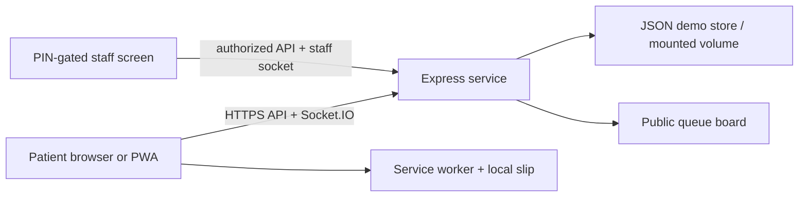

# OPD Saathi

Accessible hospital registration, live queues, emergency help and a game-style indoor wayfinder for a fictional City District Hospital. This is a demonstration prototype; it is not a surveyed hospital map or a production medical-record system.

## Start on your laptop

Install Node.js LTS, open this folder in VS Code, then run:

```powershell
npm install
npm run dev
```

Open the Vite URL printed in the terminal (normally http://localhost:5173). The command starts Vite and the Express/Socket.IO server together. Use `npm run build` for a production build, `npm run typecheck` for TypeScript checking, and `npm run test:wayfinder` for the routing tests.

Staff/counter prototype PIN: `2468`. Change it with `STAFF_PIN` before sharing a demo. This PIN is only a prototype gate; a real hospital must use an audited staff identity provider and role-based authentication.

## What works

- Welcome, registration, slip, queue, hospital wayfinding, emergency help, settings, staff, registration counter and waiting-room board screens.
- Emergency links on each screen, emergency symptoms in registration, 112/108 details, and urgent flags pinned and sounded on the staff dashboard until marked seen. Emergency cases have an immediate route to Emergency without requiring a token.
- A five-step registration flow with saved answers when going Back, department cards, microphone input where supported, assisted mode and emergency symptom signs.
- OPD slip token, department/room/doctor, queue estimate, QR, image download, print, read aloud when a matching voice exists, large text and offline-pending status. QR camera scanning is shown only when browser camera and BarcodeDetector support are available.
- Queue position, current token, provider status, near-turn banner, vibration, sound, notification permission, and a clearly labelled simulated-SMS preview.
- JSON floor plans, multi-floor Dijkstra routing, accessible routes, destinations, step directions, speech when a matching voice exists, simulated player movement, drag controls, WASD/arrow buttons, reduced motion, route replay and speed settings. No GPS or live motion tracking is used.
- Staff-only queue actions behind the PIN, persistent urgent alerts, call next, no-show, send to end, department move, status/delay, crowd levels, counter and public board. Estimates use up to the last ten completed simulated consultations plus doctor delay, rounded up to five-minute blocks.
- Socket.IO pushes queue changes between phones/computers. Public responses contain the signed-in device's own token data plus public counts/status; full patient list and urgent flags are staff-only. BroadcastChannel/localStorage also trigger same-browser refreshes without broadcasting patient data.
- Tamil is available in the main interface, registration, emergency, slip/queue, settings, departments and hospital-place labels. The wayfinder voice control is hidden by browser language availability for Tamil in the patient read-aloud button.
- PWA app shell and static hospital assets are precached. Own slip and pending offline registration are stored on the device; pending registration is submitted automatically when the network returns. Install button appears only after the browser offers installation.

## Weak connection and PWA check

In Chrome, open DevTools → Network → Offline to check cached navigation, the last local queue/slip and pending-registration banner. Restore connectivity; pending registrations should sync and replace their temporary OFF token with a server token. In DevTools → Application, inspect the manifest, service worker and Cache Storage. Run Lighthouse from Chrome DevTools on the built app and review Performance, Accessibility and PWA. The 3D bundle and two background movies are large; low-end phone Lighthouse scores can vary, and this demo has not been externally audited.

## Test with another phone on the same Wi-Fi

Run `npm run dev` on the host laptop, find the laptop's Wi-Fi IPv4 address (`ipconfig` on Windows), then open `http://<laptop-ip>:5173` on the phone. Allow the firewall prompt for Node/Vite on a private network. Use that URL in the wayfinder QR settings; localhost QR links work only on the same device. For testing across different networks, deploy the app as described below.

## Put the project online for judges

This project serves the built React app, API and Socket.IO from one Node web service, so deploy a single service with the repository connected to a Git provider. Example Render settings: Build command `npm install && npm run build`; Start command `npm start`; set `STAFF_PIN` to a private demo PIN; set a persistent volume and `DATA_DIR` to its mount directory so demo queues survive restarts. Render's Node web services accept an app bound to the `PORT` environment variable and provide an HTTPS URL. See [Render's Express deployment guide](https://render.com/docs/deploy-node-express-app) and [web-service configuration](https://render.com/docs/web-services).

After deploy, open the HTTPS URL on a phone. Socket.IO uses the same origin and should connect automatically. Check `/api/health` on the deployed host. Do not use real patient data: this prototype has no database encryption, audit-grade auth, backup plan, abuse protection, consent/deletion workflow, or security review. The JSON store is for the demo only.

## Background movies and light visual style

The full-screen hospital background has two selectable clips: `public/images/hospital-ambient.mp4` and `public/images/hospital-ambient-previous.mp4`. Choose between them in Settings → Background video. The white, teal and blue glass interface uses compact, off-center page surfaces so the film remains visible. System reduced-motion preferences are respected.

## Data and architecture

Edit hospital services in `src/data/departments.js`, public queue sample data in `src/data/patients.js`, general floor names in `src/data/hospital.js`, and the wayfinder architecture/graph in `src/data/hospital-wayfinder.json`. Interface dictionaries live in `src/i18n`.



## Known prototype limits

Tamil coverage is in place for the principal patient flows and hospital place/departments; a few wayfinder game controls, map diagrams and some staff/board labels still have untranslated English fallback text. QR camera support depends on browser capabilities and HTTPS. Voice directions depend on installed browser voices. Online deployment must be completed in your own Git/hosting account; this workspace has not been published.

## Voice assistant
A persistent **Voice Help** control is available across all app routes. It uses the browser's built-in Web Speech APIs (no paid API key required) to speak guidance and recognize commands in English, Hindi, or Tamil, based on the selected voice-guide language. Example commands include “open registration”, “find my token”, “hospital directions”, “queue status”, “staff page”, “settings”, and “emergency”.

For voice input, open the app in a supported browser (Chrome is recommended), allow microphone access when prompted, and select the desired voice-guide language in Settings. Speech recognition availability and installed voices vary by browser/device. The assistant only listens after the microphone button is tapped; it does not continuously listen in the background. Queue count spoken by the assistant reflects the data available in the current browser session, so staff should use the authenticated staff dashboard for operational queue counts.
